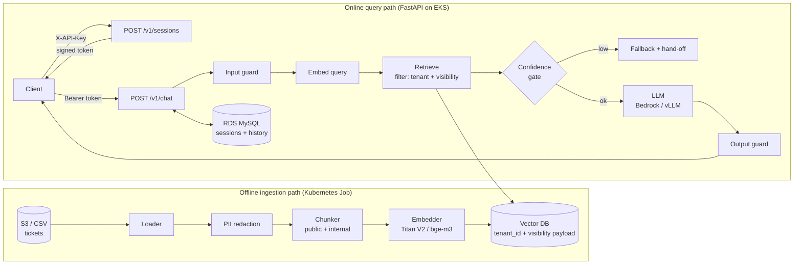

# Architecture

## Request lifecycle

1. `POST /v1/sessions` - API key → `(tenant_id, role)`; a DB session row and an HMAC token are created.
2. `POST /v1/chat` - token verified; session row re-checked (expiry/revocation); identity becomes `SessionContext`.
3. Input guard (length, prompt-injection heuristics); message redacted before storage.
4. Retrieval query = question (or previous user message + question when very short).
5. Vector search filtered by `tenant_id` and role-based `visibility`; near-duplicate chunks removed.
6. Confidence gate: no chunk ≥ `MIN_CONFIDENCE` → fallback, **LLM not called**.
7. Prompt built from role-specific system prompt + `<context>` + bounded history; LLM generates.
8. Output guard (customer role) blocks internal vocabulary; provider errors → safe fallback.
9. Both turns persisted; response carries confidence, hand-off flag, timings (and sources for agents only).

## Data model

* `Chunk(chunk_id, tenant_id, ticket_id, visibility, text, ticket_status)`
* `visibility = public` (conversation) | `internal` (internal notes, prefixed with the customer's opening question)
* MySQL: `sessions(session_id, tenant_id, role, created_at, expires_at)`,
  `messages(session_id, seq, author, content, meta, created_at)`

## Threat model (summary)

| Threat | Mitigation |
|---|---|
| Cross-tenant data access | tenant in signed token; mandatory filter in store API; runtime assertion; tests + `sa-eval` |
| Customer sees internal notes / fraud rules | visibility filter, prompt rules, output guard, optional Bedrock Guardrails |
| Prompt injection via user text or retrieved text | input heuristics; context marked as data; no tool/action capabilities |
| Stolen / forged token | HMAC signature, short TTL, server-side session check, delete endpoint |
| PII at rest | redaction before indexing and before storing chat history |
| Hallucinated policy or promises | context-only prompt, confidence gating, no account actions |
